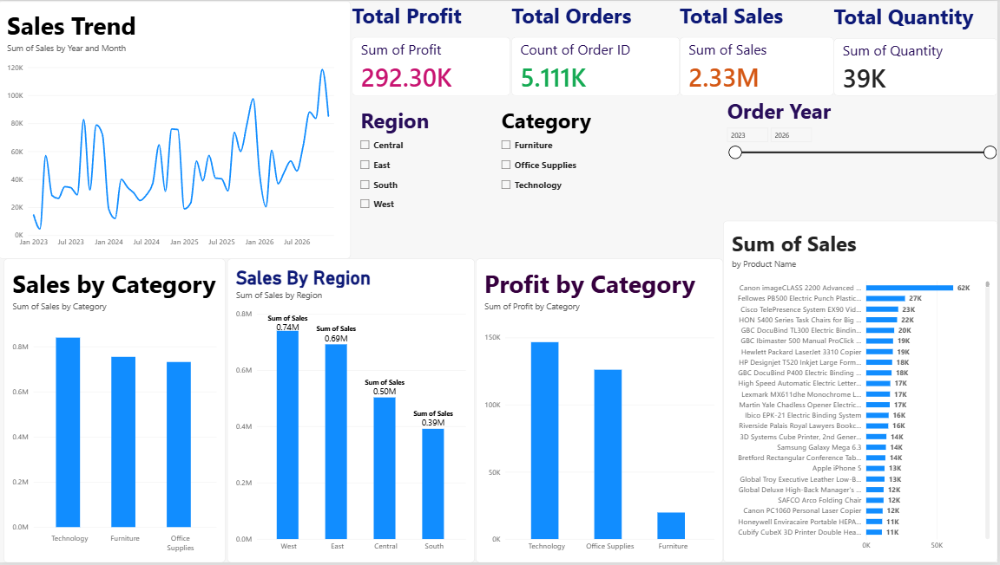

# Sales Data Analysis Dashboard (Python, SQL & Power BI)

An end-to-end sales analytics project that transforms raw retail data into actionable business insights using Python, SQL, and Power BI. The workflow includes data cleaning, exploratory data analysis, SQL validation, and an interactive Power BI dashboard.

## Project Overview

This project analyses retail sales data to understand revenue trends, product performance, regional sales, profitability, and the impact of discounts. The cleaned dataset is analysed using both Python and SQL, while Power BI provides an interactive dashboard for business reporting.

## Business Problem

A retail business needs to understand which products and regions generate the most sales and profit, which products underperform, and how discounting affects profitability. These insights can help guide business decisions.

## Objectives

- Clean and validate raw sales data.
- Calculate sales, profit, order, quantity, and profit margin KPIs.
- Identify monthly trends and top-performing products.
- Analyse sales and profitability by category and region.
- Investigate the relationship between discounts and profit.
- Build an interactive Power BI dashboard with Year, Region, and Category slicers.
- Cross-check SQL results against Python analysis.

## Technologies Used

- **Python:** Pandas, NumPy
- **Data Visualization:** Matplotlib, Seaborn
- **Database:** SQLite
- **Query Language:** SQL
- **Business Intelligence:** Power BI Desktop, DAX
- **Tools:** Git, GitHub, VS Code

## Dataset

- **Dataset:** Sample Superstore retail sales data.
- **Raw records:** 10,194
- **Duplicate records removed:** 2
- **Cleaned records:** 10,192
- **Raw dataset location:** `data/sales_data.csv`
- **Cleaned dataset location:** `data/cleaned_sales_data.csv`

Please verify the original dataset source and licence before redistributing the data.

## Project Results

| KPI | Result |
|---|---:|
| Total Sales | $2,326,153.86 |
| Total Profit | $292,273.46 |
| Total Orders | 5,111 |
| Total Quantity | 38,644 |
| Profit Margin | 12.56% |

*Results are based on the project's completed Python and SQL analysis. Displayed values may differ slightly from Power BI cards due to formatting or rounding.*

## Folder Structure

```text
Sales-Data-Analysis-Dashboard/
├── data/
│   ├── sales_data.csv
│   └── cleaned_sales_data.csv
├── docs/
│   ├── GITHUB_GUIDE.md
│   ├── INTERVIEW_NOTES.md
│   └── POWER_BI_GUIDE.md
├── images/
│   └── sales_dashboard.png
├── powerbi/
│   ├── Sales_Analysis_Dashboard.pbix
│   └── corporate_theme.json
├── reports/
│   ├── key_findings.md
│   ├── kpi_summary.csv
│   └── generated charts and analysis results
├── sql/
│   └── analysis_queries.sql
├── src/
│   ├── check_setup.py
│   ├── clean_sales.py
│   ├── sales_analysis.py
│   ├── sql_analysis.py
│   ├── run_all.py
│   └── utils.py
├── requirements.txt
└── README.md
```

## Data Cleaning Methodology

- Standardised column names.
- Removed 2 duplicate records.
- Parsed date fields and converted numeric values.
- Handled missing values in required fields.
- Removed invalid sales, quantity, and discount values.
- Preserved negative-profit records because they represent genuine losses.
- Added date and discount-related analysis columns.

## SQL Analysis

The project includes SQL queries for:

- Overall sales and profit KPIs
- Sales and profit by category and sub-category
- Regional and state-level performance
- Yearly and monthly sales trends
- Top products by sales
- Products with negative profit
- Order-level profitability
- Discount profitability analysis

The SQL pipeline stores data in SQLite and compares key results with the Python analysis.

## Power BI Dashboard Features

- KPI cards for Total Sales, Total Profit, Total Orders, Total Quantity, and Profit Margin
- Monthly sales trend
- Sales by region
- Sales by category
- Top 10 products
- Profit by category
- Year, Region, and Category slicers
- Consistent corporate theme

## Power BI Dashboard Preview



### Download the Power BI Dashboard

[Open the Power BI dashboard file](powerbi/Sales_Analysis_Dashboard.pbix)

Download the `.pbix` file and open it using Power BI Desktop to explore the dashboard.

For setup instructions and DAX measures, see [Power BI Guide](docs/POWER_BI_GUIDE.md).

## Installation and Execution (Windows)

1. Clone or download this repository.
2. Open the project folder in VS Code.
3. Create and activate a virtual environment:

```powershell
python -m venv .venv
.\.venv\Scripts\Activate.ps1
```

4. Install the required libraries:

```powershell
pip install -r requirements.txt
```

5. Verify the raw dataset:

```powershell
python src/check_setup.py
```

6. Run the complete analysis pipeline:

```powershell
python src/run_all.py
```

The pipeline cleans the data, generates analysis reports and charts, runs SQL analysis, and verifies results against Python.

## Future Improvements

- Sales forecasting using time-series models
- Customer segmentation and repeat-purchase analysis
- Automated tests for data cleaning
- Scheduled data refresh and Power BI report publishing

## Author

**Yogeshwari Sandip Pawar**

[GitHub Profile](https://github.com/yogeshwarisp) · [Project Repository](https://github.com/yogeshwarisp/Sales-Data-Analysis-Dashboard)
